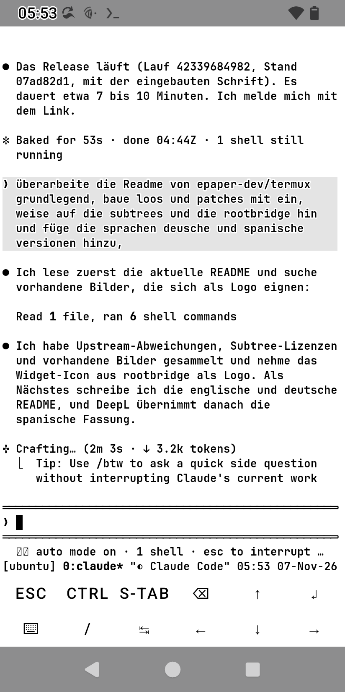
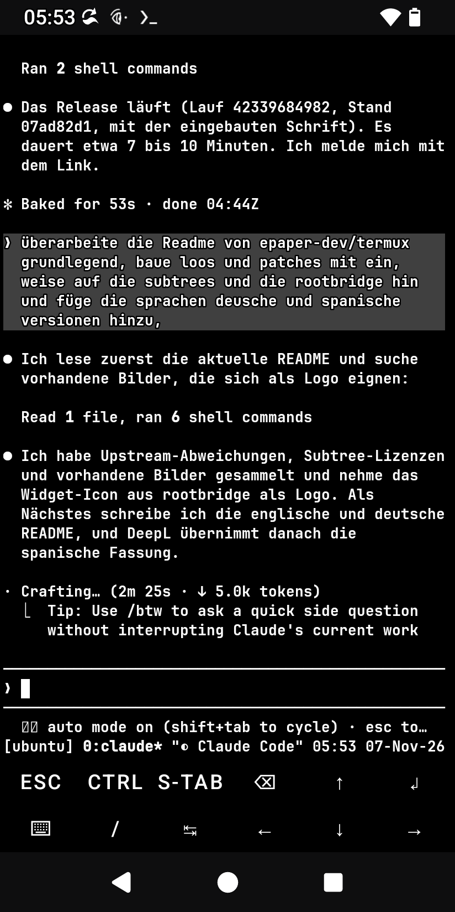

<p align="center">
  
</p>

<h1 align="center">Termux E-Paper</h1>

<p align="center">
  <b>Termux, seine Plugin-Apps und Claude Code, lesbar gemacht für E-Ink-Telefone.</b><br>
  Ein Repository, ein Signaturschlüssel, ein Release-Set.
</p>

<p align="center">
  <a href="https://github.com/epaper-dev/termux/releases/latest"></a>
  <a href="https://github.com/epaper-dev/termux/actions/workflows/release_set.yml"></a>
  <a href="https://github.com/epaper-dev/termux/actions/workflows/termux_app_tests.yml"></a>
  <a href="https://github.com/epaper-dev/termux/actions/workflows/rootbridge_tests.yml"></a>
  <a href="https://github.com/epaper-dev/termux/actions/workflows/sync_upstream.yml"></a>
  <br>
  
  <a href="https://github.com/termux"></a>
  <a href="#lizenzen"></a>
</p>

<p align="center">
  <a href="README.md">English</a> · <b>Deutsch</b> · <a href="README.es.md">Español</a>
</p>

---

## Worum es geht

Termux läuft auf E-Ink-Telefonen, ist dort aber schwer lesbar: dünne Systemschrift, ein schwarzes Terminal im hellen
Modus und Farben, die Androids *Text mit hohem Kontrast* zu hohlen Buchstaben macht. Dieses Repository hält die
Termux-App und alle ihre Plugin-Apps zusammen, bringt die Änderungen für E-Ink mit und baut alles als **ein Set mit
einem Schlüssel**. So lassen sich die Apps nebeneinander installieren und an Ort und Stelle aktualisieren.

Dazu richtet [`rootbridge/`](rootbridge/README.de.md) **Claude Code** auf dem Telefon ein: Ubuntu-Gast über proot,
Root-Aktionen mit Bestätigung in Claude Code, funktionierende Logins und Widgets. Außerdem bekommt Claude ein Theme,
das dem Telefon folgt.

<p align="center">
  
  &nbsp;&nbsp;
  
  <br>
  <sub>Dieselbe Claude-Code-Sitzung auf einem Hisense A9, das Telefon von hell auf dunkel umgeschaltet: eingebaute
  Farben und Schrift, Theme <b>Auto epaper</b>, ohne Neustart.</sub>
</p>

## Was anders ist als im Upstream-Termux

| | Änderung |
|---|---|
| 🌗 **Folgt dem Telefon** | Das Terminal selbst, nicht nur die Menüs, folgt dem Hell/Dunkel-Modus des Telefons, ohne jede Datei: eingebautes weißes Schema im hellen Modus, eingebautes schwarzes im dunklen, weißer Fensterhintergrund im hellen Modus. Alle Sitzungen wechseln gleichzeitig. |
| 🔲 **Lesbar mit *Text mit hohem Kontrast*** | Android zeichnet Text schwarz oder weiß, je nachdem ob R+G+B unter 384 liegt, und gibt ihm eine Kontur in der Gegenfarbe. Farben nahe der Mitte werden so zu hohlen Buchstaben. Die eingebauten Schemata halten jede Textfarbe klar auf einer Seite (geprüft von `BuiltInColorSchemesTest`). |
| 🔤 **Eingebaute Schrift** | [JetBrains Mono](https://github.com/JetBrains/JetBrainsMono) NL Bold statt der dünnen Monospace-Systemschrift. |
| 📣 **DECSET 2031** | Programme erfahren von Hell/Dunkel-Wechseln (`CSI ? 997 ; 1\|2 n`, Abfrage mit `CSI ? 996 n`). tmux ab 3.6 und Claude Code folgen live. |
| 🪟 **Termux:Float** | Dieselben Farbschemata, dieselbe Schrift und derselbe Hell/Dunkel-Wechsel. |
| 🔑 **Ein Schlüssel** | Alle sieben APKs tragen dasselbe Zertifikat (`sharedUserId` `com.termux`). |
| 🤖 **Claude Code** | `rootbridge/`: Installer, Root-Bridge mit Bestätigung, Widgets und das Theme **Auto epaper**, das live mit dem Telefon wechselt. |

Eigene Dateien gehen weiterhin vor: `~/.termux/colors.properties`, `colors-light.properties`, `colors-dark.properties`
(jedes Termux:Styling-Schema passt) und `~/.termux/font.ttf`.

## Installation

Das Paket besteht aus zwei Teilen: den **Termux-Apps** (Schritt 1, immer) und **Claude Code mit rootbridge** (Schritt 2,
optional). Du brauchst Android 7 oder neuer. Root (`su`, z. B. Magisk oder KernelSU) wird nur für die Root-Funktionen
von rootbridge gebraucht.

### 1. Termux-Apps

1. Lade die APKs aus dem **[neuesten Release-Set](https://github.com/epaper-dev/termux/releases/latest)** herunter:
   die App (`termux-app_…_arm64-v8a.apk` für die meisten Telefone, im Zweifel `universal`) und die gewünschten Plugins.
   `termux-api`, `termux-boot` und `termux-widget` nutzt rootbridge (Zwischenablage und Browser, Autostart nach einem
   Neustart, die Widgets **Claude** und **Ubuntu**); `termux-styling`, `termux-float` und `termux-tasker` sind optional.
   Jedes Release enthält eine `sha256sums.txt`, mit der du die Downloads prüfen kannst.
2. Du kommst von Termux aus F-Droid oder Google Play? Dann deinstalliere vorher das ganze Set, denn Android lehnt ein
   Update mit einem anderen Schlüssel ab. Beim Deinstallieren wird das Termux-Home gelöscht, kopiere also vorher heraus,
   was du brauchst.
3. Installiere zuerst die App, dann die Plugins. Alle müssen aus demselben Set stammen.
4. Öffne **Termux** einmal. Beim ersten Start werden die Basispakete eingerichtet, dafür brauchst du eine
   Internetverbindung. Öffne auch **Termux:Boot** einmal, sonst führt es nach einem Neustart keine Skripte aus.

Farben und Schrift brauchen keine Einrichtung: Das Terminal folgt dem Hell/Dunkel-Modus des Telefons.

### 2. Claude Code auf dem Telefon (optional)

In einer Termux-Shell:

```bash
pkg install -y git
git clone --depth 1 --filter=blob:none --sparse https://github.com/epaper-dev/termux
cd termux
git sparse-checkout set rootbridge
cd rootbridge
bash install.sh
```

Das Repository enthält auch die Quellen der Apps (etwa 110 MB); der Sparse-Checkout holt nur `rootbridge/` (etwa
1,5 MB), mehr braucht der Installer nicht. Den Rest richtet der Installer selbst ein: Pakete, den Ubuntu-Gast, Claude
Code und sein Theme **Auto epaper**. Weiter von Hand: die Root-Freigabe für Termux (dein Root-Manager fragt bei der
ersten Anfrage), das Widget **Claude** auf den Homescreen legen und die Claude-Anmeldung (`/login`).
Details: [rootbridge/README.de.md](rootbridge/README.de.md) ([English](rootbridge/README.md) ·
[Español](rootbridge/README.es.md)).

### Aktualisieren

Neue Release-Sets erscheinen unter **Releases**. Installiere die neuen APKs über die alten; der Schlüssel ist derselbe,
Daten und Einstellungen bleiben. Für rootbridge führst du `git pull` im geklonten Ordner `termux` aus und danach in dessen
Ordner `rootbridge/` noch einmal `bash install.sh` (der Installer ist idempotent).

## Aufbau des Repositorys

Jedes Verzeichnis ist ein **git subtree** mit seiner vollständigen Historie. Die Upstream-Projekte landen unverändert
in `master` und tragen auf `main` unsere Änderungen.

| Verzeichnis | Upstream | Was es ist |
|---|---|---|
|  [`termux-app/`](termux-app) | [termux/termux-app](https://github.com/termux/termux-app) | Die Terminal-App (Terminal-Emulator, termux-shared). Die meisten E-Paper-Änderungen liegen hier. |
| [`termux-api/`](termux-api) | [termux/termux-api](https://github.com/termux/termux-api) | Android-Schnittstellen für die Shell (Paket `termux-api`). |
| [`termux-boot/`](termux-boot) | [termux/termux-boot](https://github.com/termux/termux-boot) | Führt Skripte beim Gerätestart aus (für den Autostart von rootbridge). |
| [`termux-widget/`](termux-widget) | [termux/termux-widget](https://github.com/termux/termux-widget) | Verknüpfungen auf dem Startbildschirm (die Widgets **Claude** und **Ubuntu** von rootbridge). |
| [`termux-styling/`](termux-styling) | [termux/termux-styling](https://github.com/termux/termux-styling) | Farbschemata und Schriften. |
| [`termux-float/`](termux-float) | [termux/termux-float](https://github.com/termux/termux-float) | Terminal in einem schwebenden Fenster, mit denselben Farben und derselben Schrift wie die App. |
| [`termux-tasker/`](termux-tasker) | [termux/termux-tasker](https://github.com/termux/termux-tasker) | Tasker-Plugin. |
|  [`rootbridge/`](rootbridge/README.de.md) | – (eigenes Projekt, nur auf `main`) | Claude Code auf Android: Installer, Root-Bridge, Widgets, Theme **Auto epaper**. Hierher umgezogen aus `hisense-a9/termux-root-bridge` (archiviert). |

Die Upstream-Repositorys bringen eigene `.github`-Ordner mit. Unterhalb eines Subtrees sind sie wirkungslos, denn
GitHub liest nur die Workflows im Wurzelverzeichnis.

### Branches

| Branch | Inhalt |
|---|---|
| `master` | Eine **unveränderte Kopie von Upstream**: Jedes Verzeichnis ist der `master`-Branch von `termux/<Verzeichnis>`. Hier wird nie etwas Eigenes committet. |
| `main` | Das E-Paper-Produkt: `master` plus unsere Änderungen und `rootbridge/` (Standard-Branch). |

### Workflows

| Workflow | Was er macht |
|---|---|
| `Sync upstream` | Alle 6 Stunden: übernimmt neue Upstream-Commits nach `master`, merged `master` nach `main` und startet dann `Release set` (Release-Schlüssel, veröffentlichen). Ohne neue Upstream-Commits passiert nichts. Bei einem Merge-Konflikt öffnet er ein Issue mit den Schritten zur Lösung; `master` bleibt aktuell, `main` unverändert. Mit der Repository-Variable `RELEASE_AFTER_SYNC` = `false` entfällt das Release. |
| `Release set` | Baut die App und die sechs Plugins, signiert alle mit **einem** Schlüssel und prüft, dass sie zusammengehören (gleiches Zertifikat, `sharedUserId` `com.termux`). Mit `publish` und dem Release-Schlüssel erscheinen die APKs als einzelne Dateien unter **Releases**. `ephemeral-key` (Wegwerf-Schlüssel) testet die Pipeline und veröffentlicht nichts. |
| `Termux app unit tests` | Führt `./gradlew test` in `termux-app/` aus (Terminal-Emulator, termux-shared, App), wenn sich dort etwas ändert. |
| `Rootbridge tests` | Führt die Tests und ShellCheck von `rootbridge/` aus, wenn sich dort etwas ändert. |

Skripte: `.github/scripts/sync_upstream.sh`, `build_release_set.sh`, `make_signing_key.sh`.

## Details

### Terminalfarben

Im hellen Modus nutzt das Terminal `termux-shared/src/main/res/raw/colors_light_default.properties` (schwarz auf weiß),
im dunklen `colors_dark_default.properties` (weiß auf schwarz). Jede Textfarbe bleibt klar dunkel (helles Schema:
R+G+B unter 384) oder klar hell (dunkles Schema: 576 oder mehr, damit auch abgedunkelter Text über 384 bleibt). Die
einzige Ausnahme ist das Grau, das Claude Codes ANSI-Themes hinter deine Nachrichten legen (hell: `color7` #E4E4E4,
dunkel: `color8` #404040). Telefone ohne System-Dunkelmodus bleiben hell. `night-mode` in `termux.properties`
(standardmäßig `system`, sonst `true`/`false`) bestimmt den Modus; Menüs, Einstellungen und Dialoge folgen ebenfalls.

Dateien in `~/.termux/` gehen vor: `colors-light.properties` und/oder `colors-dark.properties` gelten in ihrem Modus,
sonst gilt `colors.properties` in beiden Modi, wie im Upstream-Termux. Der Hell/Dunkel-Teil für die Termux-App ist
auch für Upstream vorbereitet (Branch `terminal-colors-light-dark` von `epaper-dev/termux-app`).

### Hell/Dunkel-Meldungen (DECSET 2031)

Ein Programm, das `CSI ? 2031 h` setzt, bekommt `CSI ? 997 ; 1 n` (dunkel) bzw. `CSI ? 997 ; 2 n` (hell), sobald der
Hintergrund zwischen dunkel und hell wechselt, per OSC-Sequenz oder durch den Modus des Telefons. `CSI ? 996 n` fragt
den aktuellen Stand ab, DECRQM meldet den Modus. tmux ab 3.6 reicht das weiter und führt seine Hooks
`client-light-theme` / `client-dark-theme` aus. Claude Code mit dem Theme `auto` folgt sofort, das Theme **Auto epaper**
von rootbridge über diese Hooks.

### Eingebaute Schrift

Ohne `~/.termux/font.ttf` nutzen die App und Termux:Float **JetBrains Mono NL Bold** 2.304 (die Variante ohne
Ligaturen, `app/src/main/assets/fonts/JetBrainsMonoNL-Bold.ttf`). Eine eigene `font.ttf` (oder eine von
Termux:Styling gesetzte) geht weiterhin vor.

### Signaturschlüssel

Alle APKs des Sets tragen ein Zertifikat. Nur dann installiert Android die App und ihre Plugins nebeneinander, und ein
Update wird nur mit demselben Schlüssel angenommen. Der Schlüssel wird einmal mit `.github/scripts/make_signing_key.sh`
erzeugt, und der Workflow liest ihn aus vier Repository-Secrets: `SIGNING_KEYSTORE_BASE64`, `SIGNING_KEYSTORE_PASSWORD`,
`SIGNING_KEY_PASSWORD`, `SIGNING_KEY_ALIAS`. **Sichere `release.p12` und `password.txt` außerhalb von GitHub**: Secrets
lassen sich nicht zurücklesen, und ohne den Schlüssel müsste jeder Nutzer das ganze Set deinstallieren und neu
installieren.

## Lizenzen

| Teil | Lizenz |
|---|---|
| `termux-app/`, `termux-api/`, `termux-boot/`, `termux-widget/`, `termux-styling/`, `termux-float/`, `termux-tasker/` und unsere Änderungen daran | GPLv3 wie im Upstream (siehe `LICENSE.md` oder `README.md` im jeweiligen Verzeichnis; einzelne Upstream-Dateien haben andere Lizenzen, dort aufgeführt) |
| `rootbridge/` | MIT ([`rootbridge/LICENSE`](rootbridge/LICENSE)) |
| JetBrains Mono (eingebaute Schrift) | SIL Open Font License 1.1 ([`JetBrainsMono-OFL.txt`](termux-app/app/src/main/assets/fonts/JetBrainsMono-OFL.txt)) |

Termux ist ein Projekt der [Termux-Entwickler](https://github.com/termux). Dies ist ein unabhängiger Build für
E-Ink-Telefone und kein offizielles Termux-Release.
