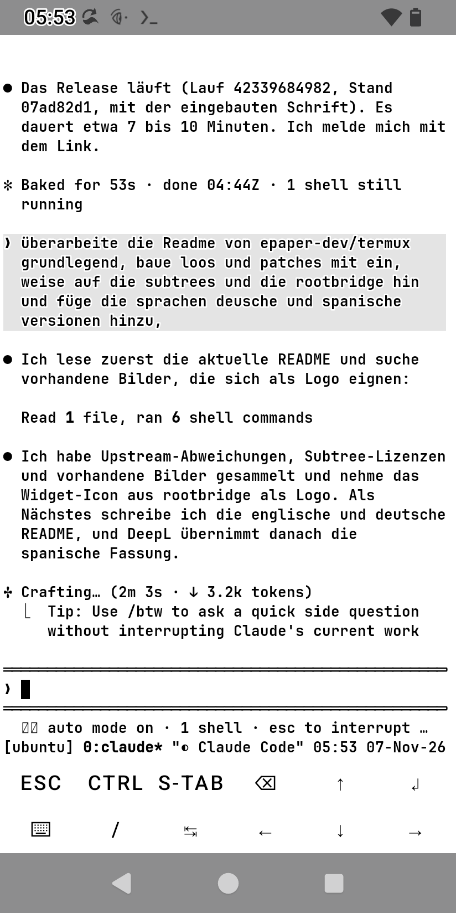
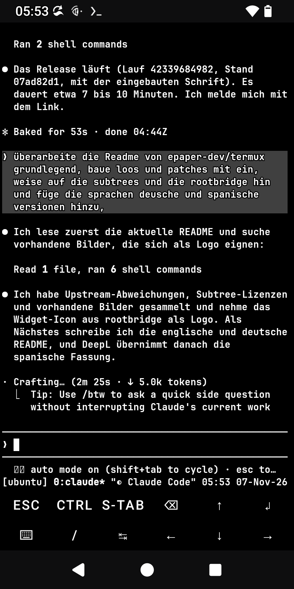

<p align="center">
  
</p>

<h1 align="center">Termux E-Paper</h1>

<p align="center">
  <b>Termux, sus apps complementarias y Claude Code, legibles en móviles con pantalla E-Ink.</b><br>
  Un repositorio, una clave de firma, un conjunto de versiones.
</p>

<p align="center">
  <a href="https://github.com/epaper-dev/termux/releases/latest"></a>
  <a href="https://github.com/epaper-dev/termux/actions/workflows/release_set.yml"></a>
  <a href="https://github.com/epaper-dev/termux/actions/workflows/termux_app_tests.yml"></a>
  <a href="https://github.com/epaper-dev/termux/actions/workflows/rootbridge_tests.yml"></a>
  <a href="https://github.com/epaper-dev/termux/actions/workflows/sync_upstream.yml"></a>
  <br>
  
  <a href="https://github.com/termux"></a>
  <a href="#licencias"></a>
</p>

<p align="center">
  <a href="README.md">English</a> · <a href="README.de.md">Deutsch</a> · <b>Español</b>
</p>

---

## De qué va esto

Termux funciona en los móviles con pantalla E-Ink, pero ahí cuesta leerlo: la fuente del sistema es muy fina, el terminal
es negro con el tema claro y la opción *Texto de alto contraste* de Android convierte algunos colores en letras huecas.
Este repositorio reúne la app de Termux y todas sus apps complementarias, añade los cambios que las hacen legibles en
E-Ink y las compila como **un único conjunto firmado con una sola clave**, para que se instalen juntas y se actualicen
sin reinstalar.

Además, [`rootbridge/`](rootbridge/README.es.md) configura **Claude Code** en el móvil (sistema invitado Ubuntu con
proot, acciones con root real confirmadas dentro de Claude Code, inicios de sesión que funcionan, widgets) y le aplica un
tema que sigue al móvil.

<p align="center">
  
  &nbsp;&nbsp;
  
  <br>
  <sub>La misma sesión de Claude Code en un Hisense A9, con el móvil pasado de modo claro a oscuro: colores y fuente
  integrados, tema <b>Auto epaper</b>, sin reiniciar.</sub>
</p>

## En qué se diferencia del Termux original

| | Cambio |
|---|---|
| 🌗 **Sigue al móvil** | El propio terminal (no solo los menús) sigue el modo claro u oscuro del móvil, sin ningún archivo: esquema blanco integrado en el tema claro, esquema negro integrado en el tema oscuro y fondo de ventana blanco en el tema claro. Todas las sesiones cambian a la vez. |
| 🔲 **Legible con *Texto de alto contraste*** | Android dibuja el texto en negro o blanco según si R+G+B < 384 y le añade un contorno del otro color, por lo que los colores cercanos al centro se ven como letras huecas. Los esquemas integrados mantienen cada color de texto claramente en un lado (lo comprueba `BuiltInColorSchemesTest`). |
| 🔤 **Fuente integrada** | [JetBrains Mono](https://github.com/JetBrains/JetBrainsMono) NL Bold en lugar de la fina fuente monoespaciada del sistema. |
| 📣 **DECSET 2031** | Los programas se enteran de los cambios entre claro y oscuro (`CSI ? 997 ; 1\|2 n`, consulta `CSI ? 996 n`). tmux 3.6+ y Claude Code los siguen en directo. |
| 🪟 **Termux:Float** | Los mismos esquemas de color, la misma fuente y el mismo cambio entre claro y oscuro. |
| 🔑 **Una sola clave** | Los siete APK llevan el mismo certificado (`sharedUserId` `com.termux`). |
| 🤖 **Claude Code** | `rootbridge/`: instalador, puente root con confirmación, widgets y el tema **Auto epaper**, que cambia en directo con el móvil. |

Tus propios archivos siguen teniendo prioridad: `~/.termux/colors.properties`, `colors-light.properties`,
`colors-dark.properties` (sirve cualquier esquema de Termux:Styling) y `~/.termux/font.ttf`.

## Instalación

El paquete consta de dos partes: las **apps de Termux** (paso 1, siempre) y **Claude Code con rootbridge** (paso 2, opcional). Necesitas Android 7 o una versión más reciente. Solo se necesita acceso root (`su`, por ejemplo, Magisk o KernelSU) para las funciones de root de rootbridge.

### 1. Aplicaciones de Termux

1. Descarga los APK del **[último conjunto de versiones](https://github.com/epaper-dev/termux/releases/latest)**: la aplicación (`termux-app_…_arm64-v8a.apk` para la mayoría de los móviles; si tienes dudas, elige `universal`) y los complementos que quieras. rootbridge utiliza `termux-api`, `termux-boot` y `termux-widget` (portapapeles y navegador, inicio automático tras reiniciar, los widgets **Claude** y **Ubuntu**); `termux-styling`, `termux-float` y `termux-tasker` son opcionales. Cada versión incluye un archivo `sha256sums.txt` con el que puedes verificar las descargas.
2. ¿Vienes de Termux desde F-Droid o Google Play? Entonces desinstala primero todo el conjunto, ya que Android rechaza una actualización con una clave diferente. Al desinstalar se borra el directorio de inicio de Termux, así que copia antes lo que necesites.
3. Instala primero la app y luego los complementos. Todos deben pertenecer al mismo conjunto.
4. Abre **Termux** una vez. Al iniciarlo por primera vez, se configuran los paquetes básicos; para ello necesitas conexión a Internet. Abre también **Termux:Boot** una vez; si no, no ejecutará ningún script tras reiniciar.

No hace falta configurar los colores ni la fuente: el terminal sigue el modo claro/oscuro del móvil.

### 2. Claude Code en el móvil (opcional)

En un shell de Termux:

```bash
pkg install -y git
git clone --depth 1 --filter=blob:none --sparse https://github.com/epaper-dev/termux
cd termux
git sparse-checkout set rootbridge
cd rootbridge
bash install.sh
```

El repositorio también incluye el código fuente de las apps (unos 110 MB); la descarga «sparse» solo descarga `rootbridge/` (unos 1,5 MB), que es todo lo que necesita el instalador. El instalador se encarga de configurar el resto: los paquetes, el sistema invitado de Ubuntu, Claude Code y su tema **Auto epaper**. Ahora, lo que hay que hacer a mano: dar permisos de root a Termux (tu gestor de root te lo pedirá la primera vez), colocar el widget **Claude** en la pantalla de inicio y acceder a Claude (`/login`).
Detalles: [rootbridge/README.es.md](rootbridge/README.es.md) ([English](rootbridge/README.md) ·
[Deutsch](rootbridge/README.de.md)).

### Actualizar

Las nuevas versiones aparecen en **Releases**. Instala los nuevos APK sobre los antiguos; la clave es la misma, y se conservan los datos y la configuración. Para rootbridge, ejecuta `git pull` en la carpeta clonada `termux` y, a continuación, en su carpeta `rootbridge/`, vuelve a ejecutar `bash install.sh` (el instalador es idempotente).

## Estructura del repositorio

Cada directorio es un **git subtree** con su historial completo. Los proyectos originales se incorporan sin cambios a
`master` y llevan nuestros cambios en `main`.

| Directorio | Upstream | Qué es |
|---|---|---|
|  [`termux-app/`](termux-app) | [termux/termux-app](https://github.com/termux/termux-app) | La app de terminal (emulador de terminal, termux-shared). Aquí están la mayoría de los cambios de E-Paper. |
| [`termux-api/`](termux-api) | [termux/termux-api](https://github.com/termux/termux-api) | API de Android para la shell (paquete `termux-api`). |
| [`termux-boot/`](termux-boot) | [termux/termux-boot](https://github.com/termux/termux-boot) | Ejecuta scripts al arrancar (lo usa el inicio automático de rootbridge). |
| [`termux-widget/`](termux-widget) | [termux/termux-widget](https://github.com/termux/termux-widget) | Accesos directos en la pantalla de inicio (los widgets **Claude** y **Ubuntu** de rootbridge). |
| [`termux-styling/`](termux-styling) | [termux/termux-styling](https://github.com/termux/termux-styling) | Esquemas de color y fuentes. |
| [`termux-float/`](termux-float) | [termux/termux-float](https://github.com/termux/termux-float) | Terminal en una ventana flotante, con los mismos colores y fuente que la app. |
| [`termux-tasker/`](termux-tasker) | [termux/termux-tasker](https://github.com/termux/termux-tasker) | Complemento para Tasker. |
|  [`rootbridge/`](rootbridge/README.es.md) | – (proyecto propio, solo en `main`) | Claude Code en Android: instalador, puente root, widgets, tema **Auto epaper**. Trasladado aquí desde `hisense-a9/termux-root-bridge` (archivado). |

Los repositorios originales traen sus propias carpetas `.github`; dentro de un subtree no tienen efecto (GitHub solo lee
los workflows de la raíz del repositorio).

### Ramas

| Rama | Contenido |
|---|---|
| `master` | Una **copia sin cambios del original**: cada directorio es la rama `master` de `termux/<directorio>`. Aquí nunca se hace commit de nada propio. |
| `main` | El producto E-Paper: `master` más nuestros cambios y `rootbridge/` (rama por defecto). |

### Workflows

| Workflow | Qué hace |
|---|---|
| `Sync upstream` | Cada 6 horas: incorpora los nuevos commits del original a `master`, fusiona `master` en `main` y luego inicia `Release set` (clave de release, publicar). Sin commits nuevos no pasa nada. Un conflicto de fusión abre un issue con los pasos para resolverlo; `master` queda al día y `main` sin cambios. Pon la variable del repositorio `RELEASE_AFTER_SYNC` en `false` para saltarte el release. |
| `Release set` | Compila la app y los seis complementos, los firma todos con **una** sola clave y comprueba que van juntos (mismo certificado, `sharedUserId` `com.termux`). Con `publish` y la clave de release, los APK aparecen como archivos sueltos en **Releases**. `ephemeral-key` (clave desechable) prueba el proceso y no publica nada. |
| `Termux app unit tests` | Ejecuta `./gradlew test` de `termux-app/` (emulador de terminal, termux-shared, app) cuando cambia. |
| `Rootbridge tests` | Ejecuta las pruebas y ShellCheck de `rootbridge/` cuando cambia. |

Scripts: `.github/scripts/sync_upstream.sh`, `build_release_set.sh`, `make_signing_key.sh`.

## Detalles

### Colores del terminal

En el tema claro, el terminal usa `termux-shared/src/main/res/raw/colors_light_default.properties` (negro sobre
blanco); en el oscuro, `colors_dark_default.properties` (blanco sobre negro). Todos los colores de texto quedan
claramente oscuros (esquema claro: R+G+B por debajo de 384) o claramente claros (esquema oscuro: 576 o más, así el texto
atenuado también queda por encima de 384). La única excepción es el gris que los temas ANSI de Claude Code ponen detrás
de tus mensajes (claro: `color7` #E4E4E4, oscuro: `color8` #404040). Los móviles sin modo oscuro del sistema se quedan
en claro. `night-mode` en `termux.properties` (`system` por defecto, o `true`/`false`) decide el modo; los menús,
ajustes y diálogos también lo siguen.

Los archivos de `~/.termux/` tienen prioridad: `colors-light.properties` y/o `colors-dark.properties` se usan en su
modo; si no, `colors.properties` se aplica en ambos modos, como en el Termux original. La parte de claro/oscuro de la app
también está preparada para el proyecto original (rama `terminal-colors-light-dark` de `epaper-dev/termux-app`).

### Avisos de claro/oscuro (DECSET 2031)

Un programa que activa `CSI ? 2031 h` recibe `CSI ? 997 ; 1 n` (oscuro) o `CSI ? 997 ; 2 n` (claro) cada vez que el
fondo cambia entre oscuro y claro, ya sea por una secuencia OSC o por el modo del móvil; `CSI ? 996 n` pregunta por el
actual y DECRQM informa del modo. tmux 3.6 y posteriores lo transmiten y ejecutan sus hooks `client-light-theme` /
`client-dark-theme`; Claude Code con el tema `auto` lo sigue al instante, y el tema **Auto epaper** de rootbridge, a
través de esos hooks.

### Fuente integrada

Sin `~/.termux/font.ttf`, la app y Termux:Float usan **JetBrains Mono NL Bold** 2.304 (la variante sin ligaduras,
`app/src/main/assets/fonts/JetBrainsMonoNL-Bold.ttf`). Un `font.ttf` propio (o uno puesto por Termux:Styling) sigue
teniendo prioridad.

### Clave de firma

Todos los APK del conjunto llevan un mismo certificado; solo así Android instala la app y sus complementos juntos, y
solo acepta una actualización con la misma clave. La clave se crea una vez con `.github/scripts/make_signing_key.sh` y
el workflow la lee de cuatro secretos del repositorio: `SIGNING_KEYSTORE_BASE64`, `SIGNING_KEYSTORE_PASSWORD`,
`SIGNING_KEY_PASSWORD`, `SIGNING_KEY_ALIAS`. **Guarda una copia de `release.p12` y `password.txt` fuera de GitHub**: los
secretos no se pueden volver a leer, y sin la clave todos los usuarios tendrían que desinstalar y reinstalar el conjunto
entero.

## Licencias

| Parte | Licencia |
|---|---|
| `termux-app/`, `termux-api/`, `termux-boot/`, `termux-widget/`, `termux-styling/`, `termux-float/`, `termux-tasker/` y nuestros cambios en ellos | GPLv3, como el original (consulta `LICENSE.md` o `README.md` de cada directorio; algunos archivos originales tienen otras licencias, indicadas allí) |
| `rootbridge/` | MIT ([`rootbridge/LICENSE`](rootbridge/LICENSE)) |
| JetBrains Mono (fuente integrada) | SIL Open Font License 1.1 ([`JetBrainsMono-OFL.txt`](termux-app/app/src/main/assets/fonts/JetBrainsMono-OFL.txt)) |

Termux es un proyecto de los [desarrolladores de Termux](https://github.com/termux); esta es una compilación
independiente para móviles E-Ink y no una versión oficial de Termux.
