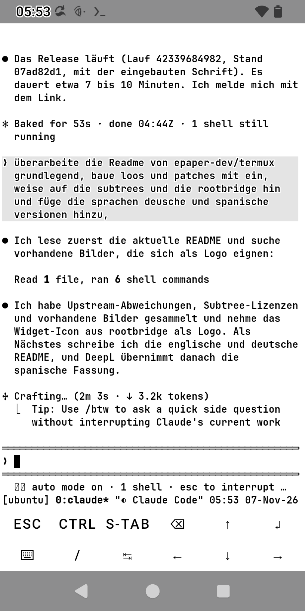
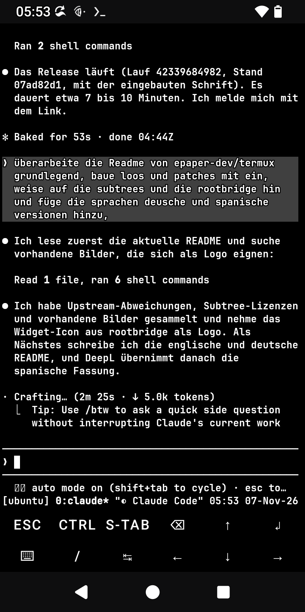

<p align="center">
  
</p>

<h1 align="center">Termux E-Paper</h1>

<p align="center">
  <b>Termux, its plugin apps and Claude Code, made readable on E-Ink phones.</b><br>
  One repository, one signing key, one release set.
</p>

<p align="center">
  <a href="https://github.com/epaper-dev/termux/releases/latest"></a>
  <a href="https://github.com/epaper-dev/termux/actions/workflows/release_set.yml"></a>
  <a href="https://github.com/epaper-dev/termux/actions/workflows/termux_app_tests.yml"></a>
  <a href="https://github.com/epaper-dev/termux/actions/workflows/rootbridge_tests.yml"></a>
  <a href="https://github.com/epaper-dev/termux/actions/workflows/sync_upstream.yml"></a>
  <br>
  
  <a href="https://github.com/termux"></a>
  <a href="#licenses"></a>
</p>

<p align="center">
  <b>English</b> · <a href="README.de.md">Deutsch</a> · <a href="README.es.md">Español</a>
</p>

---

## What this is

Termux works on E-Ink phones, but it is hard to read there: thin system font, a black terminal in the light theme,
colours that Android's *High contrast text* turns into hollow letters. This repository keeps the Termux app and all its
plugin apps together, adds the changes that make them readable on E-Ink, and builds them as **one set signed with one
key**, so they install side by side and update in place.

On top of that, [`rootbridge/`](rootbridge/README.md) sets up **Claude Code** on the phone (proot Ubuntu guest, real-root
actions confirmed inside Claude Code, logins that work, widgets) and gives it a theme that follows the phone.

<p align="center">
  
  &nbsp;&nbsp;
  
  <br>
  <sub>The same Claude Code session on a Hisense A9, the phone switched from light to dark: built-in colours and font,
  theme <b>Auto epaper</b>, no restart.</sub>
</p>

## What is different from upstream Termux

| | Change |
|---|---|
| 🌗 **Follows the phone** | The terminal itself (not only the menus) follows the light/dark mode of the phone, without any file: built-in white scheme in the light theme, built-in black one in the dark theme, white window background in the light theme. All sessions switch at once. |
| 🔲 **Readable with *High contrast text*** | Android draws text black or white by R+G+B < 384 and gives it an outline in the other colour, so colours near the middle become hollow letters. The built-in schemes keep every text colour clearly on one side (checked by `BuiltInColorSchemesTest`), and while *High contrast text* is on, the renderer does the same for the colours programs choose themselves (truecolor, 256 colours): on the default background they are pulled to the right side (`TextContrast`). With the setting off they are drawn as chosen. |
| 🔤 **Built-in font** | [JetBrains Mono](https://github.com/JetBrains/JetBrainsMono) NL Bold instead of the thin system monospace font. |
| 📣 **DECSET 2031** | Programs learn about light/dark changes (`CSI ? 997 ; 1\|2 n`, query `CSI ? 996 n`). tmux 3.6+ and Claude Code follow live. |
| 🪟 **Termux:Float** | Same colour schemes, font and light/dark switching. |
| 🔑 **One key** | All seven APKs carry the same certificate (`sharedUserId` `com.termux`). |
| 🤖 **Claude Code** | `rootbridge/`: installer, root bridge with confirmation, widgets, and the theme **Auto epaper** that switches live with the phone. |

Your own files still win: `~/.termux/colors.properties`, `colors-light.properties`, `colors-dark.properties` (any
Termux:Styling scheme works) and `~/.termux/font.ttf`.

## Install

The package has two parts: the **Termux apps** (step 1, always) and **Claude Code with rootbridge** (step 2, optional).
You need Android 7 or newer. Root (`su`, e.g. Magisk or KernelSU) is only needed for the root features of rootbridge.

### 1. Termux apps

1. Download the APKs from the **[latest release set](https://github.com/epaper-dev/termux/releases/latest)**: the
   app (`termux-app_…_arm64-v8a.apk` for most phones, `universal` if unsure) and the plugins you want. `termux-api`,
   `termux-boot` and `termux-widget` are what rootbridge uses (clipboard and browser, autostart after a reboot, the
   **Claude** and **Ubuntu** widgets); `termux-styling`, `termux-float` and `termux-tasker` are optional. Every release
   has a `sha256sums.txt` to check the downloads.
2. Coming from the F-Droid or Google Play Termux? Uninstall that whole set first, because Android refuses an update
   signed with a different key. Uninstalling deletes the Termux home, so copy what you need out of it first.
3. Install the app first, then the plugins. All of them have to come from the same set.
4. Open **Termux** once. The first start sets up the base packages and needs an internet connection. Open
   **Termux:Boot** once as well, otherwise it does not run scripts after a reboot.

The colours and the font need no setup: the terminal follows the light/dark mode of the phone.

### 2. Claude Code on the phone (optional)

In a Termux shell:

```bash
pkg install -y git
git clone --depth 1 --filter=blob:none --sparse https://github.com/epaper-dev/termux
cd termux
git sparse-checkout set rootbridge
cd rootbridge
bash install.sh
```

The repository also holds the app sources (about 110 MB); the sparse checkout fetches only `rootbridge/` (about 1.5 MB),
which is all the installer needs. The installer sets up the rest by itself: packages, the Ubuntu guest, Claude Code
and its theme **Auto epaper**. Still manual afterwards: the root grant for Termux (your root manager asks on the first
request), putting the **Claude** widget on the home screen, and the Claude login (`/login`).
Details: [rootbridge/README.md](rootbridge/README.md) ([Deutsch](rootbridge/README.de.md) ·
[Español](rootbridge/README.es.md)).

### Update

New release sets appear under **Releases**. Install the new APKs over the old ones; the key is the same, so data and
settings stay. For rootbridge run `git pull` in the `termux` folder you cloned, then `bash install.sh` in its
`rootbridge/` folder again (the installer is idempotent).

## Repository layout

Every directory is a **git subtree** with its full history. The upstream projects are taken over unchanged into
`master` and carry our changes on `main`.

| Directory | Upstream | What it is |
|---|---|---|
|  [`termux-app/`](termux-app) | [termux/termux-app](https://github.com/termux/termux-app) | The terminal app (terminal emulator, termux-shared). Most E-Paper changes live here. |
| [`termux-api/`](termux-api) | [termux/termux-api](https://github.com/termux/termux-api) | Android APIs for the shell (`termux-api` package). |
| [`termux-boot/`](termux-boot) | [termux/termux-boot](https://github.com/termux/termux-boot) | Runs scripts at boot (used by rootbridge's autostart). |
| [`termux-widget/`](termux-widget) | [termux/termux-widget](https://github.com/termux/termux-widget) | Home-screen shortcuts (rootbridge's **Claude** and **Ubuntu** widgets). |
| [`termux-styling/`](termux-styling) | [termux/termux-styling](https://github.com/termux/termux-styling) | Colour schemes and fonts. |
| [`termux-float/`](termux-float) | [termux/termux-float](https://github.com/termux/termux-float) | Terminal in a floating window; same colours and font as the app. |
| [`termux-tasker/`](termux-tasker) | [termux/termux-tasker](https://github.com/termux/termux-tasker) | Tasker plugin. |
|  [`rootbridge/`](rootbridge/README.md) | – (own project, `main` only) | Claude Code on Android: installer, root bridge, widgets, theme **Auto epaper**. Moved here from `hisense-a9/termux-root-bridge` (archived). |

The upstream repositories ship their own `.github` folders; below a subtree they are inert (GitHub only reads the
workflows of the repository root).

### Branches

| Branch | Content |
|---|---|
| `master` | An **unchanged copy of upstream**: every directory is the `master` branch of `termux/<directory>`. Nothing of our own is ever committed here. |
| `main` | The E-Paper product: `master` plus our changes and `rootbridge/` (default branch). |

### Workflows

| Workflow | What it does |
|---|---|
| `Sync upstream` | Every 6 hours: takes new upstream commits into `master`, merges `master` into `main`, then starts `Release set` (release key, publish). Without new upstream commits nothing happens. A merge conflict opens an issue with the steps to fix it; `master` stays up to date, `main` unchanged. Set the repository variable `RELEASE_AFTER_SYNC` to `false` to skip the release. |
| `Release set` | Builds the app and the six plugins, signs them all with **one** key and checks that they belong together (same certificate, `sharedUserId` `com.termux`). With `publish` and the release key the APKs appear as single files under **Releases**. `ephemeral-key` (throwaway key) tests the pipeline and publishes nothing. |
| `Termux app unit tests` | Runs `./gradlew test` of `termux-app/` (terminal emulator, termux-shared, app) when it changes. |
| `Rootbridge tests` | Runs the tests and ShellCheck of `rootbridge/` when it changes. |

Scripts: `.github/scripts/sync_upstream.sh`, `build_release_set.sh`, `make_signing_key.sh`.

## Details

### Terminal colours

In the light theme the terminal uses `termux-shared/src/main/res/raw/colors_light_default.properties` (black on white),
in the dark theme `colors_dark_default.properties` (white on black). Every text colour stays clearly dark (light scheme:
R+G+B below 384) or clearly light (dark scheme: 576 or more, so dimmed text also stays above 384). The one exception
is the grey that Claude Code's ANSI themes use behind your messages (light: `color7` #E4E4E4, dark: `color8` #404040).

Programs also pick colours of their own, which no scheme can cover: Claude Code draws its "thinking" status in a
hard-coded truecolor grey of 153 to 185, which is hollow letters on white. So, while Android's *High contrast text* is on (the view reads `high_text_contrast_enabled`
at start and whenever the window gets the focus back), the renderer (`TerminalRenderer`, `TextContrast` in
`terminal-emulator`) pulls the text colour of truecolor and of the 256 colour palette (indices 16 to 255) to the right
side of the threshold, but only for text on the default background: in the
light theme R+G+B is scaled down to at most 380, in the dark theme mixed towards white to at least 388, hue kept as far
as possible. The 16 scheme colours stay as the scheme (or your `colors.properties`) defines them, and text on a
background of its own (selection, Claude Code's message backgrounds) is not touched.
Phones without a system dark mode stay light. `night-mode` in `termux.properties` (`system` by default, or
`true`/`false`) decides the mode; menus, settings and dialogs follow it as well.

Files in `~/.termux/` override this: `colors-light.properties` and/or `colors-dark.properties` are used in their mode,
otherwise `colors.properties` applies in both modes, as in upstream Termux. The light/dark part for the Termux app is
also prepared for upstream (branch `terminal-colors-light-dark` of `epaper-dev/termux-app`).

### Light/dark notifications (DECSET 2031)

A program that sets `CSI ? 2031 h` gets `CSI ? 997 ; 1 n` (dark) or `CSI ? 997 ; 2 n` (light) whenever the background
changes between dark and light, by an OSC sequence or by the phone's mode; `CSI ? 996 n` asks for the current one,
DECRQM reports the mode. tmux 3.6 and later passes this on and runs its hooks `client-light-theme` / `client-dark-theme`;
Claude Code with the theme `auto` follows at once, rootbridge's theme **Auto epaper** via those hooks.

### Built-in font

Without `~/.termux/font.ttf` the app and Termux:Float use **JetBrains Mono NL Bold** 2.304 (the variant without
ligatures, `app/src/main/assets/fonts/JetBrainsMonoNL-Bold.ttf`). A `font.ttf` of yours (or one set by Termux:Styling)
still wins.

### Signing key

All APKs of the set carry one certificate; Android installs the app and its plugins side by side only then, and an
update is accepted only with the same key. The key is made once with `.github/scripts/make_signing_key.sh` and read by
the workflow from four repository secrets: `SIGNING_KEYSTORE_BASE64`, `SIGNING_KEYSTORE_PASSWORD`,
`SIGNING_KEY_PASSWORD`, `SIGNING_KEY_ALIAS`. **Keep `release.p12` and `password.txt` backed up outside GitHub**: secrets
cannot be read back, and without the key every user has to uninstall and reinstall the whole set.

## Licenses

| Part | License |
|---|---|
| `termux-app/`, `termux-api/`, `termux-boot/`, `termux-widget/`, `termux-styling/`, `termux-float/`, `termux-tasker/` and our changes to them | GPLv3, as upstream (see each directory's `LICENSE.md` or `README.md`; some upstream files carry other licenses, listed there) |
| `rootbridge/` | MIT ([`rootbridge/LICENSE`](rootbridge/LICENSE)) |
| JetBrains Mono (built-in font) | SIL Open Font License 1.1 ([`JetBrainsMono-OFL.txt`](termux-app/app/src/main/assets/fonts/JetBrainsMono-OFL.txt)) |

Termux is a project of the [Termux developers](https://github.com/termux); this is an independent build for E-Ink
phones and not an official Termux release.
