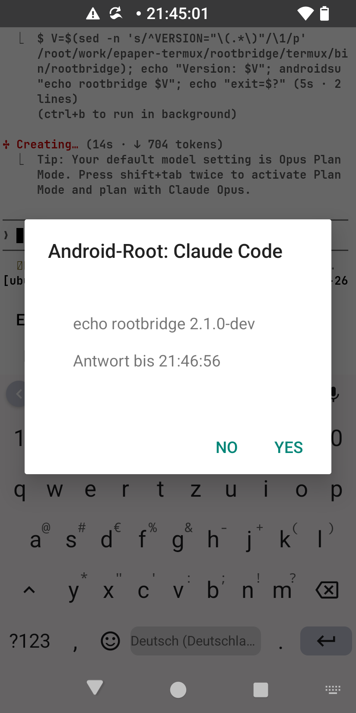

# termux-rootbridge

**Claude Code auf Android (Termux + proot-distro) – jede echte Root-Aktion wird direkt in Claude Code bestätigt, und Logins funktionieren ohne Kopierärger.**

[English](README.md) · [Español](README.es.md) · [Vergleich mit anderen Projekten](docs/COMPARISON.md) · [Login & MCP](docs/LOGIN.md) · [Sicherheit](SECURITY.md)

> **Stand: v2.1.2-dev.** Unit- und Integrationstests laufen (Guard-Hook, Login-Hook, Daemon, Installer).
> Auf einem Gerät bestätigt (Hisense A9): die Root-Rückfrage auch im Bypass-Modus, ein vollständiger Login mit
> automatischem `localhost`-Redirect, Browser-Öffnen aus dem Gast und Kopieren von Links in die Android-Zwischenablage
> (über den Daemon und mit der Taste `c` durch tmux). Noch zu prüfen: das genaue `tool_response`-Format der
> MCP-Login-Tools. Siehe [Was geprüft ist](#was-geprüft-ist).

## Welches Problem löst es?

Wer Claude Code in einem Ubuntu-Gast (proot-distro) in Termux betreibt, stößt auf drei Dinge:

1. **Echter Android-Root ist unerreichbar.** `su` in proot kollidiert mit Magisk. Ein kleiner Daemon *außerhalb*
   von proot führt `su -c` für den Gast aus, aber nur für bestätigte Befehle.
2. **Claude soll autonom arbeiten, aber nie ungefragt am System ändern.** Ein Hook macht aus jedem root-fähigen
   Befehl (`androidsu`, `adb`, `fastboot`, `su`, `magisk` ...) eine normale Rückfrage *in Claude Code* – auch im
   Bypass-Modus.
3. **Logins sind am Handy mühsam.** Der OAuth-/MCP-Link ist hunderte Zeichen lang, bricht über viele Zeilen um und
   bekommt beim Kopieren Leerzeichen. Der Link wird jetzt im Android-Browser geöffnet oder mit einer Taste sauber kopiert.

Es gibt kein zweites Terminal-Fenster und kein Popup mehr (v1 brauchte beides).

## Funktionsweise

```
Agent: Claude Code oder Codex (Ubuntu-Gast)       Termux (außerhalb proot)
───────────────────────────────────────────       ────────────────────────
Bash: androidsu 'id'
androidsu ── Anfrage (Datei in ~/.rootbridge) ─▶  rootbridge-daemon (ohne Fenster)
                                                  Android-Dialog „Android-Root: Claude Code“
                                                    ← du antwortest Ja / Nein, in Termux
                         ◀──────── Ergebnis ───   Ja → su -c 'id'      Nein → abgelehnt (Exit 99)
rootbridge-hook.py (PostToolUse, UserPromptSubmit)
  ◀── die Notiz des Daemons: „Der Nutzer hat `id` abgelehnt, keine Umgehung“
```

<p align="center"></p>

Der Dialog des Daemons für eine Anfrage: wer fragt, der Befehl, die Frist. (Die Tasten sind hier englisch: die normale Termux:API.
Die Termux:API dieses Repositorys, `api/`, zeigt sie in der Sprache des Telefons und zählt die Frist herunter.)

* **Keine Bestätigung, kein Root.** Der Daemon in Termux zeigt für jede `androidsu`-Anfrage einen Android-Dialog
  (`termux-dialog`, Paket `termux-api` und die App Termux:API) mit Befehl und anfragendem Agenten. Die Antwort ist die Ausgabe
  des Dialogs selbst, nie eine Datei, die der Gast schreiben könnte; weder Claude Code noch Codex können also etwas
  freigeben. Keine Antwort innerhalb von `ASK_TIMEOUT` (120 s), ein fehlender Dialog oder ein Befehl über 4000 Zeichen heißt: abgelehnt. Mit der Termux:API dieses Repositorys (`api/`) hat der Dialog die Tasten in der Sprache
  des Telefons (Ja/Nein, Sí/No, sonst Yes/No), einen Titel, der bis zur Frist herunterzählt und sich dann selbst schließt, und nur ein
  Tippen auf eine Taste beantwortet ihn. Mit jeder anderen Termux:API stehen die Tasten auf Englisch, die Frist im Text, und ein
  weggewischter Dialog (oder eine Tastatur, die ihn verdeckt) erscheint neu, bis du Ja oder Nein tippst; ein Ja binnen einer Sekunde
  nach dem Erscheinen gilt als Versehen und wird neu gefragt.
* **Ablehnungen erreichen den Agenten.** Der Daemon legt eine Notiz für den anfragenden Agenten ab (`~/.rootbridge/events/`),
  und der Hook `rootbridge-hook.py` (PostToolUse und UserPromptSubmit, in den Managed Settings von Claude Code und in
  `/etc/codex/requirements.toml` für Codex) gibt sie als Kontext weiter: Du hast abgelehnt, keine Umgehung (`su`, `adb`, Bridge-Dateien).
* **Der Gast ist von Termux abgeschnitten.** Agent-Sitzungen und Shells starten mit `proot-distro login --isolated` und binden nur
  `~/.rootbridge`, den gemeinsamen Speicher (`/sdcard`) und, für Voice, das PulseAudio-Cookie ein: kein Termux-Home, kein `usr`, kein Daemon, kein `su`-Wrapper
  (`GUEST_ISOLATE=off` in der Termux-Konfig schaltet das ab). Die Hooks nutzen deshalb das eigene `python3` des Gastes.
* **Autonom alles andere.** Was nicht root-relevant ist (auch `/sdcard`), läuft ohne Rückfrage.
* **Login-Links.** `/login`, `/mcp` und `claude mcp login <server>` öffnen den Browser über `BROWSER`/`xdg-open`.
  Ergebnisse von `mcp__*__authenticate` werden abgefangen: Der lange Link wird geöffnet und kopiert statt ausgegeben.

## Voraussetzungen

* Android mit Termux (F-Droid/GitHub-Build), `proot-distro` mit Ubuntu-Gast, Claude Code im Gast installiert (`install.sh` richtet fehlende Teile davon und die Pakete unten selbst ein)
* funktionierendes `su` (Magisk, KernelSU ...) – ohne `su` gehen nur die Login-Funktionen
* Termux-Pakete: `tmux proot-distro python coreutils util-linux`, optional `termux-api` (+ Termux:API-App) für die Zwischenablage
* Gast: `python3`, coreutils mit `sha256sum`, `od`, `timeout`, `shellcheck` (für die Shell-Skripte der Agenten; `install.sh`
  installiert es per `apt`)
* Claude Code ≥ 2.1.295
* Codex (standardmäßig an, `--no-codex` lässt es weg): `install.sh` installiert es mit dem offiziellen Installer; das
  Claude-Code-Plugin und die Pre-Commit-Review brauchen außerdem `git` und `nodejs` (≥ 18.18) im Gast, Codex braucht
  `bubblewrap` (`bwrap`). Der Installer richtet diese Pakete per `apt` ein.

## Installation

In einer **Termux**-Shell (nicht in proot):

```bash
pkg install -y git
git clone --depth 1 --filter=blob:none --sparse https://github.com/epaper-dev/termux
cd termux
git sparse-checkout set rootbridge
cd rootbridge
bash install.sh
```

`epaper-dev/termux` enthält auch die Termux-Apps (`app/`, `float/` und weitere, etwa 110 MB). Der
Sparse-Checkout holt nur `rootbridge/` (etwa 1,5 MB); mehr braucht der Installer nicht. Zum Aktualisieren später
`git pull` in `~/termux` und `bash install.sh` noch einmal ausführen. Ein einfaches
`git clone --depth 1 https://github.com/epaper-dev/termux` geht ebenfalls und lädt das ganze Repository.

Der Installer richtet selbst und ohne Rückfrage ein, was fehlt: die Termux-Pakete (`pkg install`), den Ubuntu-Gast
(`proot-distro install`, ein Download von einigen hundert MB), `python3`, `curl` und die Zertifikate im Gast sowie Claude Code
mit dem offiziellen Installer. Hat das Gerät schon alles, läuft nur die normale Installation. Nach einem Fehler einfach noch
einmal starten. Weiter von Hand: die Root-Freigabe für Termux (dein Root-Manager fragt bei der ersten Anfrage), Termux:Boot
einmal öffnen, das Widget **Claude** auf den Homescreen legen und die Claude-Anmeldung (`/login`; der Browser öffnet sich
von selbst). `--no-setup` ändert nichts davon und nennt nur, was fehlt (`--no-deps-check` überspringt den Paketteil,
`--no-guest` den Gastteil). `--setup`, die Option früherer Versionen, wird weiter angenommen und tut nichts Zusätzliches.

**Der autonome Modus ist standardmäßig an** (`--autonomous yes`): Der Installer setzt `skipDangerousModePermissionPrompt` in der
`~/.claude/settings.json` des Gasts, Claude Code zeigt dann keinen Warndialog für den Bypass-Modus, und `permissions.defaultMode`
auf `bypassPermissions` (nur, wenn du noch keinen Standardmodus gesetzt hast), sodass Claude Code **im Bypass-Modus startet**.
Der Bypass-Modus läuft im proot-Gast, und jeder Android-Root-Befehl fragt weiter nach (auch im Bypass-Modus). `--autonomous no`
lässt beide Einstellungen unberührt (ein früher gesetzter Wert bleibt), `--autonomous ask` fragt in einem Terminal.

Außerdem setzt der Installer das **Modell** auf `opusplan` (Opus plant, Sonnet arbeitet), ebenfalls nur, wenn die `settings.json`
noch keins enthält. `--model NAME` schreibt das angegebene Modell immer, `--model none` lässt es unberührt. Und er legt den
**Arbeitsordner `/root/work`** im Gast an, in dem Claude Code startet (`WORKDIR` in `/etc/termux-rootbridge.conf`; ein dort
gesetzter Wert bleibt). Vorher wurde der Ordner nie angelegt, sodass eine frische Installation Claude Code in `/root` startete.
Ein alter Standard `WORKDIR=/root/workspace` wird auf `/root/work` umgestellt, wenn der Ordner `/root/workspace` nicht existiert.

Danach Claude Code über das Widget **Claude** starten oder in einer Termux-Shell `claude` eingeben (Alias für
`rootbridge attach claude`). `codex` öffnet die Codex-Sitzung, `ubuntu` eine normale Ubuntu-Shell.
Nach einer Installation die Kurzbefehle mit `source ~/.bashrc` laden oder ein neues Termux-Fenster öffnen.
Der erste Claude-Start legt die Sitzung an: Daemon starten, Pakete des Gasts aktualisieren
(`apt-get update` + `upgrade`, höchstens alle 6 Stunden, siehe unten), `claude update` ausführen (ebenfalls höchstens alle 6
Stunden) und Claude Code starten; spätere Starts hängen sich nur an. **Normale Termux-Fenster bleiben reine Shells** (mit geladenen Farben),
nichts startet von selbst. Mit Termux:Boot wird die Sitzung nach einem Neustart im Hintergrund angelegt
(`rootbridge start --no-attach`). Claude **startet im Bypass-Modus** (mit `--autonomous no`: im Modus deiner
`settings.json`); mit **Umschalt+Tab** wechselst du den Modus (am Handy mit der Taste **S-TAB**, die der Installer der
Termux-Zusatztastenleiste hinzufügt, siehe unten).

Optionen: `--no-setup`, `--no-guest`, `--no-boot`, `--no-migrate`, `--no-colors`, `--no-widgets`, `--no-extra-keys`, `--autonomous yes|no|ask`, `--model NAME|none`, `--remote-name NAME`,
`--apt-upgrade 6h|<N>h|daily|always|off`, `--no-apt-upgrade`, `--claude-update 6h|<N>h|daily|always|off`, `--no-claude-update`, `--codex-update 6h|<N>h|daily|always|off`, `--no-codex-update`, `--no-claude`, `--no-codex` (`--claude` / `--codex` schalten ein Programm wieder an, siehe [Codex neben Claude Code](#codex-neben-claude-code)). Der Installer ist idempotent, sichert Geändertes und migriert die
alte v1-Popup-Bridge.

**Widgets.** Mit der App Termux:Widget gibt es drei Verknüpfungen: **Claude** (an die Claude-Code-Sitzung anhängen), **Codex** (das Codex-Fenster, siehe
[Codex neben Claude Code](#codex-neben-claude-code)) und **Ubuntu** (normale Ubuntu-Shell). Der Installer legt sie zusammen
mit dem Widget-Icon in `~/.shortcuts` ab (`termux/shortcuts/icons/widget.png`, kopiert nach `~/.shortcuts/icons/<Name>.png`,
für alle dasselbe; `tools/make-widget-icon.py` erzeugt es aus dem Logo `termux/shortcuts/icons/logo.png`). Das bunte Icon der
vorigen Version (`icons/legacy/widget-colour.png`) wird ebenfalls dadurch ersetzt. Die neutralen
`>_`-Icons früherer Versionen (`termux/shortcuts/icons/legacy`) werden dadurch ersetzt, jedes andere vorhandene Icon wird
nie ersetzt, du kannst also ein eigenes PNG dorthin legen; bei früheren Namen („Claude Code“ / „Ubuntu Shell“, „Claude >_“ / „Ubuntu >_“) wandert ein vorhandenes Icon auf den neuen Namen, und die alten Skripte werden entfernt. Sicherungen von
Widget- und Boot-Skripten landen in `~/.rootbridge/backups` (Termux:Widget listet jede Datei in `~/.shortcuts`,
Termux:Boot führt jede Datei in `~/.termux/boot` aus). `--no-widgets` überspringt das Ganze.

**Zusatztasten.** Eine Handy-Tastatur hat kein Umschalt+Tab, und Claude Code wechselt damit den Berechtigungsmodus (Plan,
Auto, Bypass). Der Installer setzt deshalb die Zusatztastenleiste von Termux in `~/.termux/termux.properties` (in einem
markierten Block, die Datei wird vorher gesichert, danach lädt Termux seine Einstellungen neu): zwei Zeilen mit je sechs Tasten,
`ESC` `CTRL` `S-TAB` `BKSP` `↑` `ENTER` und `KEYBOARD` `/` `TAB` `←` `↓` `→`. **S-TAB** sendet Umschalt+Tab, **TAB**
vervollständigt Slash-Befehle und `@`-Dateien. **KEYBOARD** blendet die Bildschirmtastatur ein oder aus (eine
ausgeblendete Tastatur kommt nicht von selbst zurück; `ENTER`, die Pfeile, `ESC` und `S-TAB` beantworten weiter Rückfragen
und Menüs). Wisch nach oben auf `←` ergibt `HOME`, auf `→` `END`. Derselbe Block setzt
`volume-keys = volume`: Die Lautstärketasten regeln die Lautstärke auch, wenn Termux vorne ist (sonst nimmt Termux sie als
CTRL und FN). Eine eigene Leiste (eine `extra-keys`-Zeile
außerhalb unseres Blocks) wird nie ersetzt, der Installer nennt dann nur die Taste, die du selbst ergänzen kannst (Vorlage:
`termux/extra-keys.snippet`). `--no-extra-keys` überspringt das Ganze, `uninstall.sh` entfernt den Block. Die Farben der
Leiste legt Termux fest, sie lassen sich von hier aus nicht ändern.

**Gerätename in Claude.** Der Installer fragt in einer interaktiven Termux-Shell nach dem Namen für
Claude Remote Control, etwa `boox-max-lumi`. Enter übernimmt den gespeicherten Namen (beim ersten Mal `android`).
Der Name bleibt in der Termux-Konfiguration gespeichert und wird an den Ubuntu-Gast weitergegeben.
Mit `bash install.sh --remote-name boox-max-lumi` setzt du ihn ohne Nachfrage. Ohne Terminal wird der vorhandene
Name beziehungsweise `android` verwendet; bei einer Installation nur mit Codex entfällt die Frage.

**Neue Unterhaltung.** `rootbridge attach claude -n` (oder `--new`) und das Widget **Claude Neu** starten Claude
ohne `--continue`. Bei laufender tmux-Sitzung entsteht ein zusätzliches Fenster; bestehende Unterhaltungen bleiben
offen. Beim normalen Start mit `--continue` prüft der Starter zuerst die lokal gespeicherten Unterhaltungen für
den aktuellen Arbeitsordner. Fehlt eine passende Unterhaltung mit Nachrichten, startet Claude automatisch neu;
nach der ersten gespeicherten Unterhaltung wird wieder fortgesetzt. Die Prüfung berücksichtigt `CLAUDE_CONFIG_DIR`
und benötigt weder eine Anmeldung noch einen API-Aufruf.

**Ende der Sitzung.** `/exit` (oder Strg+C) in Claude Code beendet alles: Das tmux-Fenster und die tmux-Sitzung schließen sich,
`rootbridge attach` kehrt zurück, und das über das Widget **Claude** geöffnete Termux-Fenster schließt sich mit. Du landest nicht in der
Ubuntu-Shell. Nur wenn Claude Code mit einem Fehlercode endet, bleibt die Gast-Shell mit einem Hinweis offen, damit die Meldung lesbar bleibt (ebenso, wenn `claude` nicht installiert ist).

**Paket-Updates im Gast.** Standardmäßig an: Beim Start der Claude-Code-Sitzung führt `rootbridge-apt`
`apt-get update` und `apt-get -y upgrade` aus, höchstens einmal in 6 h nach einem Erfolg (`APT_UPGRADE=6h`; `12h` usw. ändern den Abstand, `daily` = 24 h), und
blockiert den Start nie (kein Netz, ein Fehler oder ein Timeout geben nur einen Hinweis aus, Claude Code startet, der
nächste Start versucht es erneut). Für `apt-get upgrade` gelten standardmäßig 600 Sekunden
(10 Minuten, `APT_TIMEOUT` in `/etc/termux-rootbridge.conf`). Der Installer setzt den früheren Standard 1800
wieder auf 600; andere eingestellte Werte bleiben erhalten. Zwei Schutzmaßnahmen sind unter proot-distro mit Ubuntu 26.04 wichtig: dpkg bekommt
`-o DPkg::Path` mit `/usr/local/bin`, weil die uutils-coreutils dort die GNU-benannten Symlinks brauchen (sonst brechen
Maintainer-Skripte mit „Security violation“ ab), und die coreutils-Pakete (`APT_HOLD`) werden zurückgehalten, weil ein
Upgrade des Multicall-Binarys den Gast kaputt macht. Log: `/var/log/termux-rootbridge-apt.log` im Gast – jeder Lauf
endet mit einer Zeile `Ende: ok` (oder dem Grund), ein Lauf ohne sie wurde abgebrochen; gehaltene Pakete:
`apt-mark showhold`. Abschalten mit `bash install.sh --no-apt-upgrade` (wird in der Termux-Konfig als
`APT_UPGRADE` gespeichert, spätere Installationen behalten es, auch mit frischem Gast), bei jedem Start mit
`--apt-upgrade always`. Von Hand: `rootbridge-apt` im Gast. Alles, was per `apt` installiert ist, ist abgedeckt, auch `nodejs` und `npm`, falls du
sie nachinstallierst; globale Pakete aus `npm -g` nicht. Claude Code selbst ist ein natives Programm, das `claude update`
ohne npm ersetzt. Ein Wert, der schon in `/etc/termux-rootbridge.conf` steht, bleibt beim Installieren ohne Option
erhalten; ein älteres `daily` stellst du einmal mit `bash install.sh --apt-upgrade 6h --claude-update 6h` um.

**Speicherplatz im Gast.** Claude Code und Codex behalten jede heruntergeladene Version (je 350 bis 470 MB):
`rootbridge-update` löscht bei jedem Start die alten und behält die laufende und die neueste andere (Weg zurück). Und
unter proot wurden die harten Links von `rust-coreutils` als rund 115 Kopien eines 10-MB-Programms entpackt (1,2 GB):
Der Gast-Installer macht aus jedem Namen, den GNU coreutils auch hat, einen Link auf das GNU-Programm (die 11 Namen
nur aus uutils wie `b3sum` behalten ihre Kopie). `apt-get install --reinstall rust-coreutils` holt die Kopien zurück.
Zusammen werden so auf einem Gast nach einigen Updates rund 2,7 GB frei.

**`claude update`.** Gleiche Regeln wie bei den Paket-Updates (`CLAUDE_UPDATE=6h|<N>h|daily|always|off`, Standard `6h`): Der
Sitzungsstart führt `claude update` höchstens einmal in 6 h nach einem Erfolg aus (Stempel
`/var/lib/termux-rootbridge/claude-update-last-success` im Gast). Ein fehlgeschlagenes oder abgebrochenes Update hinterlässt
keinen Stempel, meldet es kurz und Claude Code startet trotzdem; der nächste Start versucht es erneut. Mit dem Standard kann
Claude Code bis zu 6 Stunden hinter der neuesten Version liegen. Abschalten mit `bash install.sh --no-claude-update`, bei
jedem Start mit `--claude-update always` (wird in der Termux-Konfig als `CLAUDE_UPDATE` gespeichert, spätere
Installationen behalten es, auch mit frischem Gast). Ein von Hand gestartetes `claude update` setzt den Stempel nicht.

**Startzeit von Hooks und Tools.** Claude Code schließt nach jedem Prozessstart alle Dateideskriptoren bis zum
Limit (`ulimit -n`), und unter proot ist jedes `close()` ein abgefangener Syscall: Androids Standard von 32768 kostete
2,5 bis 4 s pro gestartetem Prozess, jeder Hook und jeder Tool-Aufruf brauchte 4 bis 9 s statt unter einer Sekunde.
`rootbridge-claude` und die Funktion `claude()` starten Claude Code deshalb mit `NOFILE_LIMIT` (Standard 2048, `0` =
nicht ändern; `/etc/termux-rootbridge.conf` im Gast). Das Limit wird nur gesenkt, nie erhöht, und nur für Claude: die
Shell drumherum behält ihres. Wirkt nach `install.sh` und einem Neustart der Claude-Code-Sitzung.

**Farben und Theme.** Der Installer schreibt keine Farbdatei. Der E-Paper-Build von Termux (`epaper-dev/termux`) bringt ein
helles und ein dunkles Schema mit und folgt dem Hell/Dunkel-Modus des Telefons: Das Terminal ist im Hellmodus hell und im
Dunkelmodus dunkel, ganz ohne Datei; `~/.termux/colors-light.properties`, `colors-dark.properties` und `colors.properties`
überschreiben das nur. Farbdateien, die frühere Versionen installiert haben (`colors.properties` mit der hellen Palette,
`colors-light.properties`), werden entfernt, solange sie noch genau so sind wie installiert, weil sie das eingebaute Schema
überdecken würden; eine Datei, die du geändert hast, bleibt. `--no-colors` lässt Farbdateien und das Claude-Code-Theme in
Ruhe. Außerdem setzt der Installer `"theme": "custom:epaper"` in der `~/.claude/settings.json` des Gasts (andere
Schlüssel bleiben) und legt das Theme **Auto epaper** an (`~/.claude/themes/epaper.json`, Basis `light-ansi`: die 16 Farben des Termux-Schemas, die dem Schwellwert von
„Text mit hohem Kontrast“ ausweichen; eine
eigene Datei bleibt). Claude Codes eigenes `auto` wählt nur `light` oder `dark`, deshalb meldet Termux einen Wechsel
zwischen hell und dunkel (DECSET 2031) an tmux, dessen Hooks `client-light-theme` / `client-dark-theme` dann
`rootbridge theme light|dark` aufrufen: Es stellt die Basis zwischen `light-ansi` und `dark-ansi` um (bzw.
`light-daltonized`/`dark-daltonized`, `light`/`dark`, wenn du das einträgst). Eine laufende
Claude-Code-Sitzung übernimmt die geänderte Theme-Datei und wechselt die Farben live (auf dem Gerät bestätigt, ohne
Neustart). `THEME_RESTART=on` in `~/.config/termux-rootbridge/config` ist nur eine Notlösung für eine Version, die das
nicht tut: Es startet Claude Code mit `--continue` neu (eine laufende Antwort bricht ab). `THEME_FOLLOW=off` schaltet die
Hooks ab. Ein anderes
Theme jederzeit mit `/theme`. Jede neue interaktive Termux-Shell führt
`termux-reload-settings` aus, ebenso die Termux:Widget-Verknüpfungen vor dem Anhängen. Andere Termux-Builds haben kein
eingebautes helles Schema; dort ein Schema nach `~/.termux/colors.properties` kopieren.

**Fester Name in der Remote-Control-Ansicht** (claude.ai/code): Standard ist `android`, ein einfaches `bash install.sh`
setzt ihn also. Anderer Name: `bash install.sh --remote-name NAME`. Dieser Name steht danach in der Termux-Konfig
(`REMOTE_NAME`) und wird bei jeder späteren Installation ohne Option wiederverwendet, auch bei frischem Gast oder nach
`uninstall.sh`; der Gast-Installer schreibt `CLAUDE_ARGS="--remote-control android --continue"`.
`--remote-control NAME` schaltet Remote Control ein und betitelt die Sitzung in der Remote-Control-Ansicht. Diese
Remote-Control-Sitzung wird über Neustarts und `/clear` wiederverwendet und behält ihren Namen, auch einen per
`/rename` vergebenen. Für einen anderen Namen genügt ein einmaliges `/rename NAME`. Ein `--name` gibt es bewusst nicht:
Es würde den Namen zusätzlich im Rahmen des Eingabefelds im Claude-Code-Fenster anzeigen.

## Codex neben Claude Code

`install.sh` richtet standardmäßig **Codex** (OpenAIs Coding-Agent) neben Claude Code ein. `--no-codex` lässt es nur für
diesen Aufruf weg. Ein späterer Aufruf ohne diesen Zusatz richtet Codex, Termux-Kurzbefehl, Widget und mit Claude Code
den Review-Hook wieder ein, auch wenn `TOOL_CODEX=off` gespeichert war.
`--no-claude` gibt dir Codex allein: kein Claude Code, keine Managed Settings, keine Hooks, kein Plugin (Guard, Plugin und
Pre-Commit-Review leben alle in Claude Code); eines der beiden Programme bleibt immer. Die Claude-Wahl bleibt für spätere
Installationen gespeichert (`TOOL_CLAUDE`, wieder an mit `--claude`). `TOOL_CODEX` hält die aktuelle Auswahl für die Starter
fest. Zum sofortigen Wiederherstellen einer bisherigen Installation: `bash install.sh --codex`, danach in Termux
`source ~/.bashrc` oder ein neues Fenster öffnen.

* **Installation.** Im Gast: `git`, `bubblewrap` (`bwrap`) und mit beiden Programmen `nodejs` per `apt` (das Plugin braucht
  Node.js 18.18 oder neuer), Codex mit dem offiziellen Standalone-Installer (`chatgpt.com/codex/install.sh`, nicht
  interaktiv, nach `~/.local/bin`). Der Installer schreibt die Hooks und deklariert das Codex-Plugin in den Managed
  Settings (`extraKnownMarketplaces` mit der HTTPS-Quelle und `enabledPlugins`), ohne `claude plugin …` auszuführen.
  Claude Code lädt `codex@openai-codex` beim Start selbst nach; dafür ist Netz nötig. Falls es noch nicht aktiv ist,
  prüfe `/plugin` und lade es mit `/reload-plugins` neu oder starte Claude Code erneut. Bis das Plugin bereit ist,
  blockiert der Pre-Commit-Hook Commits. Ein zweiter Installer-Lauf lädt nichts nach, wenn alle Voraussetzungen da sind;
  ein fehlendes `bwrap` wird auch bei bestehendem Codex nachinstalliert. `--no-codex`, `--no-claude` und die Deinstallation
  entfernen die eigene Plugin-Deklaration, andere Plugin-Einträge bleiben erhalten.
* **Widget „Codex“** und `rootbridge attach codex`: ein zweites Fenster in derselben tmux-Sitzung. Unter proot scheitert die
  bubblewrap-Sandbox von Codex bei jedem Befehl (`unsupported host mount`), deshalb läuft Codex standardmäßig **ohne eigene
  Sandbox**: Der Installer setzt `CODEX_ARGS="--dangerously-bypass-approvals-and-sandbox"` in `/etc/termux-rootbridge.conf`
  (eigene Argumente bleiben); `install.sh --no-codex-bypass` entfernt es wieder und merkt sich die Wahl (`CODEX_BYPASS`).
  Codex bekommt keinen eigenen Android-Root: Wie Claude Code erreicht es Root nur über `androidsu`, und der Daemon fragt dich.
  Der verwaltete Hook `rootbridge-hook.py` (`/etc/codex/requirements.toml`, in `/hooks` von Codex ohne Prüfung; eine eigene
  `/etc/codex/requirements.toml` bleibt unberührt) sagt Codex, wenn du abgelehnt hast.
* **Anmeldung.** `rootbridge codex-login` führt `codex login` mit der Browser-Übergabe aus (`--device-auth`, wenn es keinen
  Browser gibt). `rootbridge status` zeigt, ob Codex, seine Anmeldung, das Plugin und der Hook da sind.
* **Beide bleiben aktuell.** Der Start eines der beiden Fenster ruft `rootbridge-apt` und danach `rootbridge-update` auf:
  `claude update` und `codex update`, jeweils höchstens alle 6 h nach einem Erfolg (`CLAUDE_UPDATE` /
  `CODEX_UPDATE` = `6h|<N>h|daily|always|off`, Stempel in `/var/lib/termux-rootbridge/`; `--codex-update M`,
  `--no-codex-update`). Starten zwei Sitzungen gleichzeitig, kommen sie nacheinander dran (Sperre), und ein fehlgeschlagener
  Schritt hält den Start nie auf. `nodejs` und `git` sind `apt`-Pakete, `rootbridge-apt` hält sie also aktuell.
* **Plugin manuell aktualisieren.** Beim Start gibt es kein automatisches Marketplace- oder Plugin-Update. Führe bei Bedarf
  im Ubuntu-Gast zuerst `/root/.local/bin/claude plugin marketplace update openai-codex` und danach
  `/root/.local/bin/claude plugin update codex@openai-codex` aus. Starte Claude Code anschließend neu.
* **Pre-Commit-Review.** Mit beiden Programmen lässt ein Hook in den Managed Settings (`codex-precommit-review.py`, Timeout
  1560 s, `onFailure: "block"`) Codex jeden `git commit` von Claude Code prüfen. Eine erste Zeile `ALLOW` lässt den Commit
  durch; `BLOCK` oder keine klare Antwort hält ihn an und gibt Codex' Befunde an Claude, das sie behebt und erneut committet.
  Es ist eine strikte Schleife: Nach einem `BLOCK` kommt derselbe Diff nie durch, nur ein geänderter Diff, den Codex danach
  freigibt; ein freigegebener Diff wird gemerkt. Fail-closed: Ohne Codex-Anmeldung, Plugin oder `node`, oder wenn Codex oder `git`
  scheitert, wird der Commit blockiert. Notausgang, nur für dich: `rootbridge codex-off` / `codex-on` (Claude Code neu
  starten) oder `CODEX_PRECOMMIT=off` in der Umgebung, mit der Claude Code startet. **Bis du dich bei Codex angemeldet hast,
  ist jeder Commit von Claude Code blockiert.** Der Hook zerlegt den Befehl wie eine Shell und prüft ein `git commit`, das ausgeführt wird (auch nach `cd`, mit
  `git -C`, hinter `sudo` / `env` / `time`, in `bash -c '…'` und `$(…)`); Text in Anführungszeichen oder Heredocs zählt nicht.
  Git-Aliase (`git ci`) und Skripte, die committen, erkennt er nicht, und die Prüfung betrachtet den ganzen Arbeitsbaum
  (staged und unstaged, Binäränderungen eingeschlossen) sowie, wenn derselbe Befehl `git add` ausführt, die noch nicht
  verfolgten Dateien, die dabei dazukommen können (sie stehen in keinem Diff).
  Codex blockiert nur bei hoher Schwere (ein Bug, der etwas kaputt macht, eine Sicherheitslücke, ein Secret, Datenverlust,
  ein verschluckter Fehler); Kleineres kommt als Hinweis hinter `ALLOW`. Die Prüfung sieht den Arbeitsbaum, wie er beim
  Start des Befehls ist: Was derselbe Befehl vor dem Commit noch ändert (`sed -i … && git commit -a`, ein Build-Skript),
  ist nicht erfasst.
  Codex prüft mit Effort `high` innerhalb eines Budgets von 1500 s ab Start des Hooks (das Hook-Timeout von 1560 s liegt
  darüber, denn der eigene Abbruch von Claude Code beendet einen Hook ohne Urteil). Jeder `git`-Aufruf hat ein Zeitlimit und
  eine Größenkappe, das Log ist privat (0600), wird rotiert und enthält keine Befehlsargumente, und was an Claude geht,
  wird von Steuerzeichen befreit, gekürzt und als Fremdtext gekennzeichnet. Pro Gerät lassen sich in der Umgebung, mit der
  Claude Code startet, `CODEX_PRECOMMIT_TIMEOUT_S` (60-3000), `CODEX_PRECOMMIT_ATTEMPTS` (1-5),
  `CODEX_PRECOMMIT_GIT_TIMEOUT_S` (1-300) und `CODEX_PRECOMMIT_EFFORT` (`none` bis `xhigh`, Standard `xhigh`) und
  `CODEX_PRECOMMIT_MODEL` (Standard: das neueste Sol-Modell mit dieser Stufe aus Codex' eigener Modellliste
  `~/.codex/models_cache.json`, sonst `gpt-6.1-sol`) setzen; das Hook-Timeout in den
  Managed Settings ist zusammen mit dem Budget anzuheben.
* **Daten.** Der Diff und alles, was Codex im Arbeitsbaum liest, gehen an OpenAI, unter dem Konto, mit dem du dich angemeldet
  hast. Die Sandbox von Codex beschränkt das Schreiben, nicht das Lesen: Es kann mehr vom Gast lesen als das Repository.

## Bedienung

| Befehl (Termux) | Wirkung |
|---|---|
| `rootbridge start` | Daemon + Session; mit `--no-attach` im Hintergrund (Termux:Boot ruft das nach einem Neustart auf) |
| `claude` / `rootbridge attach claude` | Claude-Code-Sitzung öffnen oder an die laufende Sitzung anhängen (Widget **Claude**) |
| `claude -n` / `claude --new` | neue Claude-Unterhaltung in einem eigenen Fenster starten |
| `codex` / `rootbridge attach codex` | an das Codex-Fenster anhängen (Widget **Codex**; die Session wird angelegt, wenn sie fehlt) |
| `ubuntu` / `rootbridge shell` | normale Ubuntu-Shell in diesem Terminal (startet den Daemon für `androidsu`, aber weder Claude Code noch eine tmux-Sitzung; Widget „Ubuntu“) |
| `rootbridge attach` | Standardprogramm öffnen: Claude Code, bei einer Installation ohne Claude Code stattdessen Codex |
| `rootbridge status` | Daemon, Session, Gast-Installation, letzte Audit-Zeilen |
| `rootbridge login <server>` | `claude mcp login <server>` mit Browser-Übergabe |
| `rootbridge codex-login` | `codex login` mit Browser-Übergabe (`--device-auth` ohne Browser) |
| `rootbridge stop` | Session und Daemon stoppen |
| `rootbridge guard-off` / `guard-on` | Notschalter für die Hooks |
| `rootbridge codex-off` / `codex-on` | Notschalter für die Codex-Pre-Commit-Review (Claude Code neu starten) |
| `ptt start` / `stop` / `toggle` / `status` | Push-to-Talk: drückt im Claude-Code-Fenster eine Taste für `/voice` (siehe unten) |
| `rootbridge voice start\|stop\|status\|grant` | PulseAudio und Mikrofon für `/voice`; `grant` gibt Termux die Mikrofon-Berechtigung von Android (Root) |
| `rootbridge voice speak on\|off\|toggle\|stop\|status` | Vorlesen der Antworten an oder aus (`off` beendet auch, was gerade gelesen wird), `stop` nur das Lesen jetzt |

In Claude Code ändert sich nichts: Du sagst, was du willst. Braucht Claude Root, ruft es `androidsu '<befehl>'`
auf, und du siehst eine Rückfrage mit genau diesem Befehl. Jede Entscheidung steht in `~/.rootbridge/audit.log`.

### Sprachdiktat (`/voice`) und Push-to-Talk

Standardmäßig an; `--no-voice` lässt es weg (gespeichert als `VOICE`, eine Neuinstallation behält die Wahl). Es braucht Claude Code. Der Installer richtet ein:

* **`sox`** im Gast (`rec`, darüber nimmt Claude Code auf) und **PulseAudio** in Termux. PulseAudio hört nur auf `127.0.0.1`, lässt einen Client nur mit seinem Cookie
  ein (privat in Termux; der Gast bekommt `PULSE_COOKIE`) und trägt das Mikrofon des Telefons (`~/.config/pulse/default.pa`: Termux' eigene Datei plus die Mikrofonquelle und 200 % Verstärkung, weil die
  Android-Quelle „Spracherkennung“ leise ist). Es startet mit der Sitzung (`rootbridge start` / `attach`); eine eigene `default.pa` bleibt.
* **Einstellungen von Claude Code**: `~/.claude/keybindings.json` bekommt `meta+k` = `voice:pushToTalk`, `~/.claude/settings.json` bekommt
  `"voice": {"enabled": true, "mode": "tap"}`. Beides nur, wo du noch nichts entschieden hast (eine vorhandene Belegung der Aktion oder ein `voice`-Wert bleibt).
  `tap` passt zu beiden Auslösern: Die Seitentaste startet beim Drücken und schickt beim Loslassen ab, der Home-Langdruck startet und der nächste
  schickt ab (Android meldet kein Loslassen, dazwischen sprichst du freihändig). Zum Starten muss das Eingabefeld leer sein. `/voice hold` geht mit
  `ptt` weiterhin, aber mit der Seitentaste bricht ein kurzer Druck ab (die Wiederholung beginnt 1,2 s später), und der Home-Langdruck lässt den Text dann
  im Eingabefeld, statt ihn abzuschicken.
* **`ptt`**: `ptt start` drückt die Taste für dich, `ptt stop` lässt sie los. `ptt toggle` startet oder stoppt in einem Aufruf (das führen der Home-Langdruck und das Launcher-Symbol aus). `ptt` folgt dem Modus von
  `/voice` in Claude Code (`PTT_MODE=auto`, der Standard: es liest `voice.mode` aus den Einstellungen des Gastes). Im Modus `hold` wiederholt es Alt+K
  alle 50 ms, wie eine gehaltene Taste (Claude Code hält die Taste für losgelassen, wenn 200 ms nichts kommt, deshalb startet jede Runde nur `tmux`; die Wiederholungen beginnen `PTT_WARMUP` ms (1200) nach der ersten
  Taste, denn dann startet Claude Code seinen Recorder, und ein Loslass-Zeitgeber, der in diesen Moment läuft, beendet die Aufnahme immer wieder; alle Tasten laufen über einen `tmux -C`-Client, und endet Claudes Recorder `rec`, hören die Wiederholungen auf),
  und nur dein eigenes `stop` beendet die Aufnahme; ohne Stopp enden die Wiederholungen nach `PTT_MAX` Sekunden (120). Im Modus `tap` drücken `start`,
  `stop` und `toggle` je einmal, und Claude Code entscheidet: Der erste Druck startet (das Eingabefeld muss leer sein), der nächste stoppt und sendet. `ptt` drückt nur eine Taste in einem tmux-Fenster (`PTT_TARGET`, Standard
  `ubuntu:claude`; `PTT_KEY`, Standard `M-k`) und passt damit zu jedem Programm, das auf eine Taste hört. Ein kurzer hoher Ton sagt,
  dass Claude Codes Recorder läuft (das Mikrofon ist offen, jetzt sprechen), ein tieferer, dass er beendet ist (`PTT_BEEP=off` in der
  Termux-Konfig schaltet sie ab).
* **Mikrofon-Berechtigung von Android** für Termux (eine Laufzeit-Berechtigung: sie ist mit jeder Neuinstallation der App weg; die Termux-Apps teilen
  eine Benutzerkennung, und nur die **App Termux:API** deklariert `RECORD_AUDIO`, sie muss also installiert sein). Sie braucht Root:
  auf einem Terminal fragt der Installer danach (der Root-Manager meldet sich) und überspringt es, wenn das Mikrofon schon geht; in einem
  Skriptlauf gibt er nur den Hinweis aus. `rootbridge voice grant` holt sie jederzeit, `rootbridge voice status` zeigt PulseAudio und Mikrofon,
  `rootbridge voice start|stop` steuern den Audio-Server von Hand.
* **Vorlesen**: Claudes Antworten liest **Piper** vor, eine lokale Sprachausgabe ohne Netz (im Gast in `/opt/piper`, Stimme
  `de_DE-kerstin-medium`), oder Articulino mit deiner eigenen Stimme, sobald du sie aufgenommen hast (siehe unten). Ein Stop-Hook in den Managed Settings gibt jede Antwort weiter, ohne Codeblöcke, Tabellen und URLs und ohne
  Markdown-Zeichen; der Ton geht über dasselbe PulseAudio wie das Mikrofon. Ein PreToolUse-Hook liest außerdem Claudes kurze Zwischenstände
  zwischen zwei Werkzeugaufrufen („Ich baue jetzt …“) vor, jeden einmal, aus dem Sitzungsprotokoll. Die Texte kommen nacheinander dran. Abschicken eines neuen Prompts unterbricht es nicht,
  die nächste Antwort kommt danach dran. Wenn `ptt` startet (Home-Langdruck, Seitentaste) und solange Claude Code aufnimmt, pausiert das
  Vorlesen, sonst nähme das Mikrofon die Stimme auf, und geht danach an derselben Stelle weiter.
  Nach der Installation ist das Vorlesen an. Schalten: Widget **Vorlesen** (an/aus, mit Toast; aus beendet auch das laufende Lesen) und
  Widget **Stopp** (nur jetzt still), beide in `~/.shortcuts/tasks/` (sie laufen im Hintergrund), oder `rootbridge voice speak on|off|toggle|stop`. Ein Prompt, der nur aus einem Stoppwort besteht („Stopp“, „Halt“, „Ruhe“, „Still“, „Stop“; gesprochen oder getippt), beendet das Vorlesen samt Warteschlange sofort und geht nicht an Claude.
  `rootbridge voice speak first` liest nur eine Kurzfassung jeder Antwort: den ganzen ersten Absatz und die letzte Frage weiter unten (Datei `~/.rootbridge/speak-first`; die erste Installation mit Sprache schaltet sie ein, `SPEAK_SHORT=set` in der Konfig merkt sich das), `all` wieder die ganze Antwort.
  Damit die Kurzfassung trägt, steht im Block des Installers in `~/.claude/CLAUDE.md` (Vorlage `guest/templates/speech.claude.md`): zuerst eine
  Zusammenfassung von höchstens fünf Sätzen, Fragen an dich ganz am Ende. Antwortet Claude Code auf Deutsch (`"language": "german"` in
  `~/.claude/settings.json`), kommen die deutschen Vorlagen (`*.de.claude.md`), damit englische Regeln die Antworten nicht ins Englische ziehen.
  Im Gast liest `rootbridge-speak "Text"` beliebigen Text vor, `rootbridge-speak --stop` beendet ihn, `rootbridge-speak --record` nimmt deine Stimme auf. Eine andere Piper-Stimme: `PIPER_VOICE`
  (Pfad zur `.onnx`-Datei, die `.onnx.json` daneben). Auf dem A9 braucht Piper etwa so lange, wie der Text dauert; es liefert satzweise.
  Englische Fachbegriffe (Pull Request, Commit, Branch, Hook, …) spricht die Stimme englisch aus: `guest/claude/speak-english.txt`
  führt sie mit ihrer Lautschrift in `[[…]]` (eingedeutschte Formen wie „gemergt“ mit deutscher Schreibung, „gemörtscht“); ein weiteres Wort:
  dort eine Zeile (Wort, Tab, Ersatz), dann erneut `install-guest.sh` (es überschreibt die installierte Kopie neben `speak.py`).
  **Mit deiner eigenen Stimme:** `setup-guest.sh` installiert zusätzlich Articulino (`/opt/articulino`, etwa 230 MB); deine Stimme
  nimmst du im Gast mit `rootbridge-speak --record` auf (etwa 10 s ruhig sprechen). Danach liest ein kleiner Dienst (`speak-server.py`,
  etwa 500 MB, solange er läuft; er beendet sich nach 30 Minuten ohne Text) mit deiner Stimme; der erste Text nach seinem Start braucht
  etwa 5 s länger. Ohne Aufnahme oder ohne Articulino liest Piper. Fehlt die Aufnahme (etwa nach einer Neuinstallation), fragt der Start
  von Claude Code danach: `j` nimmt gleich auf, Enter oder `n` fragt beim nächsten Start wieder, „nie“ nicht mehr (Datei `voice-never` neben `voice.wav`); ohne Antwort startet Claude Code nach 60 s.
  **Musik und Anrufe:** Während vorgelesen wird, holt der Daemon in Termux über die Termux:API dieses Repositorys den Audio-Fokus für
  Sprache; Android dreht Musik leiser (wie bei einer Navi-App) und danach wieder auf. Während eines Telefonats wird nichts vorgelesen, ein
  eingehender Anruf beendet das Vorlesen. Mit der Standard-Termux:API spielt die Musik einfach weiter.

**Auslöser ohne Root** (die Termux-App dieses Repositorys, `app/`, zeigt Android „Termux push to talk“ an; jeder führt `ptt toggle` aus: ein
Ereignis, das erste startet das Sprechen, das nächste stoppt es):
* **Langer Druck auf Home**: Einstellungen, Apps, Standard-Apps, Digitaler Assistent, „Termux push to talk“. Manche Telefone zeigen diese Auswahl
  nicht (das Hisense A9 nicht); die App ist trotzdem ein gültiger Assistent, und mit Root setzt du ihn selbst:
  `rootbridge voice assistant on` (zurück mit `off`, prüfen mit `status`). „Beenden erzwingen“ von Termux in den App-Infos nimmt Termux die
  Rolle, danach tut der lange Druck nichts mehr: wieder `rootbridge voice assistant on`.
* **Das Symbol „Termux push to talk“** im Launcher, auch als Knopf auf dem Homescreen und für Einstellungen, die einer Taste eine App zuweisen.

**„Listening“, aber kein Text:** Ein Recorder (`rec`), den Claude Code liegen gelassen hat (anthropics/claude-code#110732), behält den
Ton, und jede neue Aufnahme bekommt Stille. `ptt start` beendet im Modus hold einen solchen Recorder vor der ersten Taste, und `ptt stop`
schaut 3,5 s später noch einmal nach, damit das Mikrofon nach dem Stoppen nicht an bleibt.

Die Bedienungshilfen des A9 bieten für die Seitentaste nur feste Aktionen (Bildschirm leeren, Musik, Home, Menü, Hintergrundlicht, nichts), keine
App: Für die Seitentaste nimm `--sidekey` (unten).

**Die Tasten bei der Installation:** Auf einem Terminal fragt `install.sh` nach jeder Taste, über die noch nicht entschieden ist:
Seitentaste (`--sidekey`, Standard nein), langer Druck auf Home (`--home-key`, Standard ja) und Headset-Taste (`--headset`, Standard ja).
Die Antwort steht danach in der Konfig (`SIDEKEY`, `HOMEKEY`, `HEADSET`), spätere Läufe fragen nicht mehr; die `--no-…`-Formen schalten ab.
Der Installer richtet im selben Lauf alles ein: je einen Tasten-Leser für Seiten- und Headset-Taste und die Assistenten-Rolle für Home (Root;
bei jedem Lauf neu, falls „Beenden erzwingen“ sie genommen hat). Ohne Terminal fragt er nicht und nennt den Befehl für Home.

**Seitentaste des Hisense A9** (`--sidekey`, standardmäßig aus, gespeichert als `SIDEKEY`): Seitentaste halten = aufnehmen, loslassen = stoppen. Der Installer legt
`sidekey-ptt` nach `$PREFIX/bin`; es hält ein root-`cat` auf `/dev/input/event2` (die Taste, Scancode 766) und ruft `ptt start` / `ptt stop`.
Kurz- und Doppeldruck bleiben bei der E-Ink-App; ihren Langdruck auf „Nothing“ stellen. `rootbridge start|attach` starten den Leser (eine Instanz),
`--no-sidekey` entfernt ihn. Es ist eine Brücke, bis die E-Ink-App und die Termux-App das selbst können.
Die **Taste eines Kabel-Headsets** schaltet um (Langdruck startet, loslassen und sprechen, der nächste Langdruck schickt ab: Die Taste
schließt beim Halten das Mikrofon kurz; ein kurzer Druck startet und stoppt weiter die Musik):
Ein eigener Leser, `headset-ptt` (`--headset`), liest die Tasten der Headset-Buchse (das Eingabegerät „… Button Jack“, `KEY_MEDIA`) als root, auch bei gesperrtem Handy.
Er nimmt das Gerät für sich, damit Android keinen Langdruck mehr sieht (vorher wechselte die Musik beim Halten zwischen Pause und
Abspielen, und Androids Sprachsuche startete); Kurz- und Doppeldruck sowie lauter/leiser kommen über ein virtuelles Gerät
(„rootbridge headset“) bei Android an. Endet der Leser, gehört das Gerät wieder Android.

## Logins und MCP-Links

Kurzfassung (Details: [docs/LOGIN.md](docs/LOGIN.md)):

* Im Login-Dialog **`c`** drücken – Claude Code kopiert den Link in die Android-Zwischenablage (braucht die
  tmux-Einstellungen, die der Installer setzt).
* `/login`, `/mcp` und `claude mcp login` **öffnen den Browser selbst**.
* Bei claude.ai-Connectors (`authenticate`-Tools) öffnet ein Hook den Link, und Claude schreibt eine
  Kurzmeldung statt der langen URL. `AUTH_OPEN=copy` kopiert nur, `AUTH_OPEN=off` schaltet es ab.

## Was geprüft ist

| Durch automatische Tests belegt | Auf einem echten Gerät noch zu prüfen |
|---|---|
| Melde-Hook (12 Tests): nur Notizen des eigenen Agenten, Claude Code und Codex, bereinigter Text, still bei Fehlern | `tool_response`-Form der MCP-Login-Tools; `updatedToolOutput` |
| Daemon: der Dialog entscheidet (Ja, Nein, weggedrückt, gescheitert, keine Antwort, fehlend, einer nach dem anderen), anfragender Agent, Notizen für den Hook, gefälschte Dateien zählen nicht, lange Befehle, URL-Prüfung (Checks) | — |
| Login-Hook (19 Tests: Antwortformen, URL-Regeln, Modi) | — |
| Installer: Staging-Root, Idempotenz, v1-Migration, Deinstallation | — |
| Codex neben Claude Code: Installationsoptionen und gespeicherte Wahl, Update-Schritte mit Stempeln und Sperre, tmux-Fenster, `codex-login` / `codex-off` / `status`, die Pre-Commit-Schleife (Stub-`node`) | `codex-login` und das Widget **Codex** auf einem Gerät; `claude plugin update`, `codex update` und `onFailure: "block"` nach einem Absturz des Hooks; `bwrap` auf anderen Geräten |
| Sprache und Seitentaste: Installationsoptionen und gespeicherte Wahl, `default.pa` (unsere, deine, Update mit Backup), `rootbridge voice`, Einstellungen und Tastenbelegung im Gast ohne deine zu überschreiben, `sox` und Piper nur mit Claude Code, Vorlesen (Schalter, Stopp eines echten Prozesses, Widgets, Hooks; `tests/test_speak.py` mit Stubs für `piper` / `play`, den Articulino-Dienst und `articulino_onnx`), Deinstallation (Stubs für `pulseaudio` / `pactl` / `su` / `pkg`) | das Mikrofon mit echter Hardware, der Ton von Piper und Articulino am Lautsprecher, der Download von Articulino, `pm grant` mit echtem Root (Magisk-Rückfrage), `sidekey-ptt` an der echten Taste, die Mikrofon-Berechtigung nach einer Neuinstallation von Termux |

Auf einem Gerät bestätigt (Hisense A9, 04.11.2026): Installer, Farben und Theme, apt-Upgrade, `claude update`, das
Dateideskriptor-Limit, Widgets, Sitzungsende mit `/exit`, die Root-Rückfrage im Bypass-Modus (der Hook fragte in Claude Code, `androidsu` lief erst nach
der Antwort), ein vollständiger `/login` mit automatischem `localhost`-Redirect (ohne Code einzufügen), Browser-Öffnen aus dem Gast und Kopieren von Links in die
Android-Zwischenablage (`--copy-only` über den Daemon und die Taste `c` durch tmux).

Tests starten: `python3 -I -m unittest discover -s tests && bash tests/test_daemon.sh`.

## Grenzen

Das Projekt schützt vor **unbeabsichtigten** Aktionen, nicht vor einem feindlichen Agenten: Root im Gast teilt sich das
Termux-Home mit dem Daemon. Die ehrliche Liste steht in [SECURITY.md](SECURITY.md).

## Deinstallation

```bash
bash uninstall.sh      # behält ~/.rootbridge (Audit-Log, Sicherungen) und die Konfiguration
```

Er entfernt die Widgets (auch **Codex**), die Programme und die Hooks, die Codex-Pre-Commit-Review eingeschlossen. Codex selbst,
seine Anmeldung (`~/.codex`) und das Plugin bleiben im Gast.

## Verwandte Projekte

Andere Wege, Claude Code auf Android zu bringen, lösen die *Installation*; dieses Projekt löst *Root-Bestätigung,
Start und Logins* darüber: [bd-loser/claude-code-termux](https://github.com/bd-loser/claude-code-termux),
[ferrumclaudepilgrim/claude-code-android](https://github.com/ferrumclaudepilgrim/claude-code-android),
[Crypt0Shmipt0/root-aicli](https://github.com/Crypt0Shmipt0/root-aicli). Details: [docs/COMPARISON.md](docs/COMPARISON.md).
Nicht mit Anthropic verbunden.

## Lizenz

[MIT](LICENSE).
